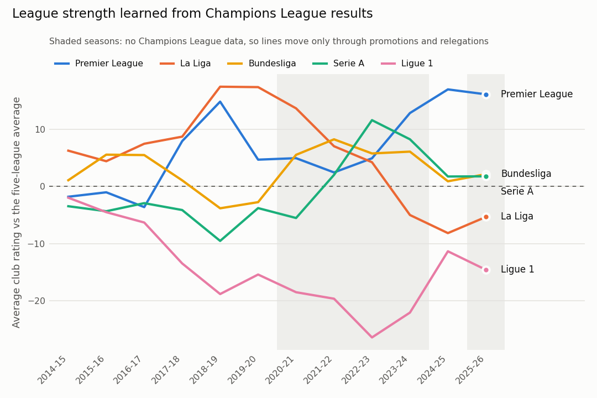

# Football Match Analysis & Prediction

Pre-match predictions and post-match analysis for Europe's top 5 leagues, with honest,
reproducible evaluation.

**Status:** live — daily forecasts, scoring and Telegram posts run automatically on GitHub Actions.

## Quick start

```bash
python -m venv .venv && source .venv/bin/activate
pip install -r requirements.txt
export PYTHONPATH=src

python -m fa.data.load_results          # ~22k matches + odds -> data/football.duckdb
python -m fa.run_baselines              # week 1: tune Elo, evaluate baselines
python -m fa.run_week2                  # week 2: Dixon–Coles goals model (~30 s)
python -m fa.run_shots                  # week 2b: does shot data help? (~1 min)
python -m fa.run_form                   # week 2c: does form / this-season data help? (~1 min)
python -m fa.data.load_european         # Champions League history (once)
python -m fa.run_cl                     # week 2d: comparing clubs across leagues
python -m pytest -q                     # unit tests
```

## Weekly predictions

```bash
python -m fa.data.load_results          # pull the latest results first
python -m fa.predict                    # upcoming matches in the next 8 days
python -m fa.score                      # score past forecasts: the live track record
```

## Automation (GitHub Actions)

`.github/workflows/daily.yml` runs `python -m fa.daily --post` every day at 06:23 UTC on
GitHub's servers: download results, refresh forecasts, score finished matches, and post
to Telegram by day (every day: full-time reviews of the matches just played; Monday:
scorecard, who-deserved-it, season tables; Tuesday: midweek forecasts; Friday: weekend
forecasts). It then commits `records/` and the reports, so
every forecast gets a public, timestamped commit before kickoff.

Setup, once, in the repo on github.com → **Settings → Secrets and variables → Actions**:

| Kind | Name | Value |
|---|---|---|
| Secret | `FOOTBALL_DATA_API_KEY` | your football-data.org key |
| Secret | `TELEGRAM_BOT_TOKEN` | your bot token from @BotFather |
| Variable | `TELEGRAM_CHAT_EN` | `@your_english_channel` |
| Variable | `TELEGRAM_CHAT_AR` | `@your_arabic_channel` (optional) |

Test with **Actions → Daily pipeline → Run workflow** (untick "Post" for a dry run).
Run the same thing locally with `python -m fa.daily` (dry run) or `--post`.

What must survive between runs lives in `records/` (forecasts, season simulations, the
team-name map, the posted log). Local runs merge with it, so nothing is lost; run
`git pull` before working locally, since the workflow commits every day.

### Track record rules (fixed before any result was seen)

- For each match, only the **latest forecast made before kickoff** counts; kickoff times
  are stored in UTC with every forecast.
- The first forecasts (saved before kickoff times were stored) count only if made at
  least 2 hours before the match day began.
- Every eligible forecast is scored; nothing is removed afterwards. Backtests can't leak
  in: a forecast saved after kickoff is never eligible.

### Season simulations

```bash
python -m fa.season_sim                 # title / top-4 / relegation chances, saved weekly
python -m fa.season_sim --backtest      # check the simulator against past seasons
```

Remaining fixtures are the home/away pairs not yet played (every top-5 league is a double
round-robin). Each simulation draws a result from the production model, then a
consistent scoreline, so goal difference can break ties. Backtest from 1 Jan and 1 Mar
of 2024-25 and 2025-26: Brier 0.013 (title), 0.047 (top 4), 0.051 (relegation) against
0.049 / 0.165 / 0.132 without the model; final points within ~4 on average. Teams given
~28% relegation chances went down 17% of the time (29 teams), a hint of pessimism
about struggling sides worth rechecking. See `reports/season_sim_backtest.md`.

### Cards and Telegram

```bash
python -m fa.cards --handle @your_channel     # PNG cards in English and Arabic -> reports/cards/<date>/
python -m fa.telegram                         # dry run: what would be posted
python -m fa.telegram --send                  # post to Telegram
```

Cards: one per big match (probabilities, predicted score, goal markets, expected goals),
one per competition with every upcoming match, a weekly scorecard that includes the
misses, a season-simulation table per league (with the biggest movers since last week),
a post-match "who deserved it?" card per league built from shots on target, and a
**full-time review** per big match: the result next to the forecast saved before kickoff
(right or wrong), the result the chances deserved, and how the matchday moved the team's
title / top-4 / relegation chances (season simulated from just before and just after it).
Each match is reviewed once, as soon as its shot data is published (usually the next day). Arabic cards are laid out right to left; club names come from
`src/fa/data/team_names_ar.csv` (clubs missing there are shown in English and listed).
Premier League match cards also show **team news** (who is out or doubtful), from the
official Fantasy Premier League API (`python -m fa.data.team_news`, free, no key; saved to
`records/team_news.csv` and ignored once older than 2 days). The API-Football free plan
was checked first (`python -m fa.data.injuries_probe`): it has no current-season injuries.
Fonts: Noto Sans and Noto Sans Arabic (SIL Open Font License, see `assets/fonts/OFL.txt`).

Telegram setup: create a bot with @BotFather, add it as an admin of your channel, and
put `TELEGRAM_BOT_TOKEN=...` and `TELEGRAM_CHAT=@your_channel` (or `TELEGRAM_CHAT_EN` /
`TELEGRAM_CHAT_AR` for one channel per language) in `.env`. Posted cards are logged in
`records/posted.csv`, so nothing is posted twice.

`reports/track_record.md` shows log loss, accuracy, exact scores, over 2.5 / both teams
to score, model vs market, and breakdowns by competition and week.

Writes `reports/predictions/<date>.md` and appends every forecast, with a timestamp, to
the `forecasts` table, so forecasts can be scored once the matches are played.
Fixtures come from the football-data.org API (free key, see below), which lists the
whole season ahead plus the Champions League; market odds are merged in from
football-data.co.uk's `fixtures.csv` when it already lists the match. Without a key,
`fixtures.csv` alone is used (it only covers the next weekend, updated a few days before).

**API key (free):** register at football-data.org, then create `.env` in the project root:

```
FOOTBALL_DATA_API_KEY=your-key-here
```

`.env` is git-ignored: never commit a key.

**Team names** differ between sources ("Manchester City FC" vs "Man City"). For each
league the ~20 names are matched as a one-to-one assignment on name similarity, so
look-alikes can't collide; Champions League clubs are then matched by API team id.
The result is cached in `data/team_map.csv`; fix any mistake in
`src/fa/data/team_aliases.csv` and rerun with `--refresh-teams`.
Use `--as-of 2026-05-14 --fixtures file.csv` to backtest on a past date.

If football-data.co.uk is unreachable, use `--source github-mirror` (results + shots, no
odds) or `--source openfootball` (results only). Without odds, the bookmaker baseline is skipped. Downloads are cached in `data/raw/`.

## Data

| Source | What | Notes |
|---|---|---|
| [football-data.co.uk](https://www.football-data.co.uk) | Results + market odds, 2014-15 → now | Default. Check their terms before any commercial use. |
| [GitHub mirror](https://github.com/datasets/football-datasets) | Results + shots | Fallback copy of football-data.co.uk, no odds. |
| [openfootball](https://github.com/openfootball/football.json) | Results only | Fallback. 2024-25 La Liga and Serie A each miss ~10 matches. |

Table `matches`: one row per match (`league, season, date, home_team, away_team,
home_goals, away_goals, result, odds_*`). Table `predictions`: every model's
H/D/A probabilities for scored seasons.

## Evaluation protocol

- **Time-based split, never shuffled:** train 2014-15 → 2023-24, tune on 2024-25,
  test once on 2025-26. Using the future to predict the past is the #1 football-model bug.
- **Elo predictions use only pre-match ratings** (enforced by `test_elo_has_no_lookahead`).
- **Metrics:** log loss, Ranked Probability Score (the football standard), Brier,
  accuracy, and calibration plots. Accuracy alone is misleading.
- **Significance:** paired bootstrap intervals on score differences.

## Baselines (week 1)

| Model | What it knows |
|---|---|
| Uniform | Nothing (1/3 each) |
| League base rates | Home advantage and draw rate per league |
| Elo | Team strength, updated after every match |
| Bookmakers | The market (margin removed) — the hardest bar |

Full results: [`reports/week1_baselines.md`](reports/week1_baselines.md).

## Goals model (week 2)

Dixon–Coles: each team gets attack and defence strengths; expected goals for both
sides give a full scoreline distribution (and so H/D/A). Recent matches are weighted
more (tuned half-life), teams with little data are shrunk toward average, promoted
teams start as weak, and the model is refit weekly so it never sees the future.

Main finding: Dixon–Coles and Elo are statistically tied on the test season; a blend
of the two is slightly better than either. Both only use results and goals, so closing
the gap to the market needs new information (shots, xG, lineups), not a new formula.

Full results: [`reports/week2_goals_model.md`](reports/week2_goals_model.md).

## Shots experiment (week 2b)

Same goals model, but team strengths are learned from a mix of real goals and
shot-based expected goals (≈ 0.35 × shots on target, fitted per league). Shots are a
less noisy signal than goals, so this is "new information" rather than a new formula.

Result: shots improve the goals model and the Elo blend on both validation and test
seasons, and the tuned half-life halves (365 → 180 days): with a cleaner signal the
model can track current form. The gains are consistent but, on one season of ~1,750
matches, not yet statistically conclusive.

Full results: [`reports/week2b_shots.md`](reports/week2b_shots.md).

## Form experiment (week 2c)

Hypothesis: predictions should lean on this season's results and recent form. Tested by
adding last-5 form (points, goal difference, shots-on-target difference), season-so-far
points and goal difference, and rest days to a stacked logistic regression over the
Elo and Dixon–Coles signals.

Result: season-so-far data adds nothing (Elo and the time-decayed goals model already
contain it), last-5 form helps by a statistically insignificant ~0.001, rest days nothing.
Notably, once everything else is known, shots-based form carries positive weight but
points-based form carries *negative* weight: teams winning without creating chances tend
to regress. The production model stays unchanged.

Full results: [`reports/week2c_form.md`](reports/week2c_form.md).

## Champions League: comparing leagues (week 2d)

All clubs share one rating pool. Domestic matches move points only within a league, so
only European matches can change a league's average: Champions League results set the
relative strength of the leagues. Clubs outside the top 5 learn only from Europe.

Data: openfootball Champions League results 2014-15..2019-20 and 2024-25 (932 matches),
plus this season's from the football-data.org API. The source spells some clubs
differently across seasons ("SL Benfica" / "Sport Lisboa e Benfica"); spellings are
merged within a country when one name's distinctive words contain the other's.

Result vs the same model with all leagues held equal: better on validation (0.940 vs
0.944) and clearly better on matches between two different top-5 leagues, tied overall
on the 2024-25 test season. Never worse, not statistically proven (~190 matches a season).
The Premier League comes out strongest and Ligue 1 weakest, by modest margins.



Full results: [`reports/week2d_champions_league.md`](reports/week2d_champions_league.md).

## Layout

```
src/fa/
  config.py              leagues, seasons, split
  data/load_results.py   download + validate + load into DuckDB
  models/baselines.py    uniform, base rates, bookmaker
  models/elo.py          Elo ratings + rating-gap -> H/D/A model
  models/poisson.py      Dixon–Coles goals model + weekly walk-forward
  eval/metrics.py        log loss, RPS, Brier, bootstrap, calibration
  run_baselines.py       week 1 experiment
  run_week2.py           week 2 experiment
  run_shots.py           week 2b experiment
  run_form.py            week 2c experiment
  run_cl.py              week 2d experiment
  data/load_european.py  Champions League history
  models/cross_elo.py    one rating pool across leagues
  models/cl_predict.py   Champions League predictions
  features/form.py       form features (no look-ahead)
  predict.py             predictions for upcoming fixtures
  score.py               live track record
  daily.py               the whole pipeline for scheduled runs
  records.py             forecasts and simulations mirrored in records/*.csv
  cards.py               PNG cards, English + Arabic
  cards_season.py        season-table and who-deserved-it cards
  cards_review.py        full-time review cards
  season_sim.py          season simulations + backtest
  telegram.py            posts cards to Telegram
  data/fixtures_api.py   football-data.org client
  data/team_names.py     cross-source team-name matching
  data/team_news.py      Premier League injuries and suspensions (Fantasy PL API)
tests/                   unit tests (incl. no-look-ahead checks)
```

## Roadmap

1. ✅ Data + baselines
2. ✅ Goals model (Dixon–Coles) + Elo blend, shots-informed ratings, form experiment
3. Post-match analysis from StatsBomb event data (xG timeline, shot maps, pass networks)
4. LLM-written previews and reports, grounded in computed numbers, checked for invented stats
5. ✅ Publish predictions before kickoff; score them after (public track record)
6. Write-up

*This project is for analysis and learning, not betting advice.*
