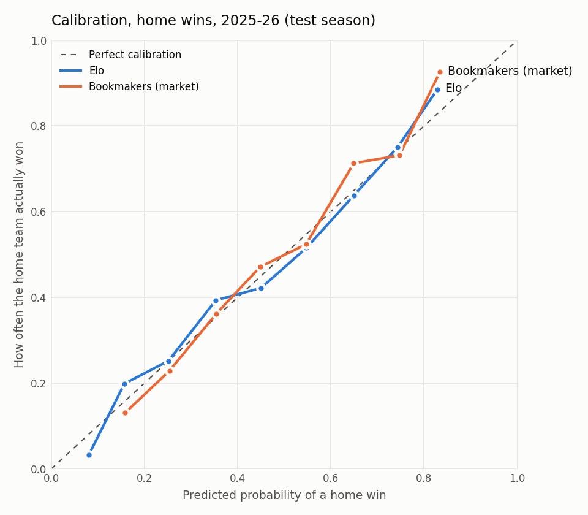

# Week 1: Baselines

Data source: **football-data** · 21,589 matches · top 5 leagues, 2014-15 to 2025-26

Split (by time, never shuffled): train 2014-15–2023-24 (first season is Elo warm-up) · tune on **2024-25** · test once on **2025-26**.

## Results on the test season (2025-26)

| Model | Log loss ↓ | RPS ↓ | Brier ↓ | Accuracy ↑ | Matches |
|---|---:|---:|---:|---:|---:|
| Uniform (1/3 each) | 1.0986 | 0.2354 | 0.6667 | 44.0% | 1752 |
| League base rates | 1.0712 | 0.2288 | 0.6478 | 44.0% | 1752 |
| Elo | 0.9960 | 0.2032 | 0.5942 | 51.5% | 1752 |
| Bookmakers (market) | 0.9784 | 0.1977 | 0.5825 | 53.4% | 1752 |
| Always pick home win | — | — | — | 44.0% | 1752 |

## Validation season (2024-25, used for tuning)

| Model | Log loss ↓ | RPS ↓ | Brier ↓ | Accuracy ↑ | Matches |
|---|---:|---:|---:|---:|---:|
| Uniform (1/3 each) | 1.0986 | 0.2362 | 0.6667 | 42.0% | 1752 |
| League base rates | 1.0786 | 0.2330 | 0.6534 | 42.0% | 1752 |
| Elo | 0.9846 | 0.2004 | 0.5869 | 53.1% | 1752 |
| Bookmakers (market) | 0.9640 | 0.1945 | 0.5731 | 53.6% | 1752 |
| Always pick home win | — | — | — | 42.0% | 1752 |

## Is the difference real? (paired bootstrap, 2,000 resamples, test season)

| Comparison | Mean difference | 95% interval | Verdict |
|---|---:|---|---|
| Elo vs League base rates | -0.0751 | [-0.0929, -0.0565] | A is better |
| Elo vs League base rates (RPS) | -0.0256 | [-0.0315, -0.0195] | A is better |
| Elo vs Bookmakers | +0.0175 | [+0.0099, +0.0247] | B is better |

Negative means the first model has the lower (better) score.

## Tuned Elo settings

`k=20`, `home_adv=105`, `season_regress=0.0`, `new_team_offset=100`, goal-margin multiplier on.

Top 5 settings by validation log loss:

|   k |   home_adv |   season_regress |   new_team_offset |   valid_log_loss |
|----:|-----------:|-----------------:|------------------:|-----------------:|
|  20 |        105 |             0.00 |               100 |           0.9846 |
|  20 |         90 |             0.00 |               100 |           0.9846 |
|  20 |         75 |             0.00 |               100 |           0.9847 |
|  15 |         60 |             0.05 |               100 |           0.9847 |
|  15 |         75 |             0.05 |               100 |           0.9847 |

If these scores are within ~0.001 of each other, the settings are effectively tied:
don't read meaning into the exact winner.

## Sanity check: current top-rated teams

| League | Top 3 by Elo now |
|---|---|
| BUNDESLIGA | Bayern Munich (1873), Dortmund (1708), Leverkusen (1682) |
| EPL | Man City (1776), Arsenal (1774), Liverpool (1656) |
| LALIGA | Barcelona (1845), Real Madrid (1767), Ath Madrid (1652) |
| LIGUE1 | Paris SG (1814), Lille (1653), Lyon (1630) |
| SERIEA | Inter (1827), Napoli (1692), Roma (1685) |

## Calibration

Points near the dashed line mean "when the model says 60%, it happens about 60% of the time".

## How to read these numbers

- **Log loss / RPS / Brier**: lower is better. RPS is the football standard because it treats H < D < A as ordered.
- **Uniform log loss is ln 3 ≈ 1.0986.** Anything above that is worse than guessing.
- **Accuracy is misleading on its own.** Draws are ~25% of matches but almost never the most likely outcome, so every model rarely predicts them.
- **The bar for a real model** (week 2): beat Elo with a clear bootstrap interval, and close as much of the gap to the bookmakers as possible.
