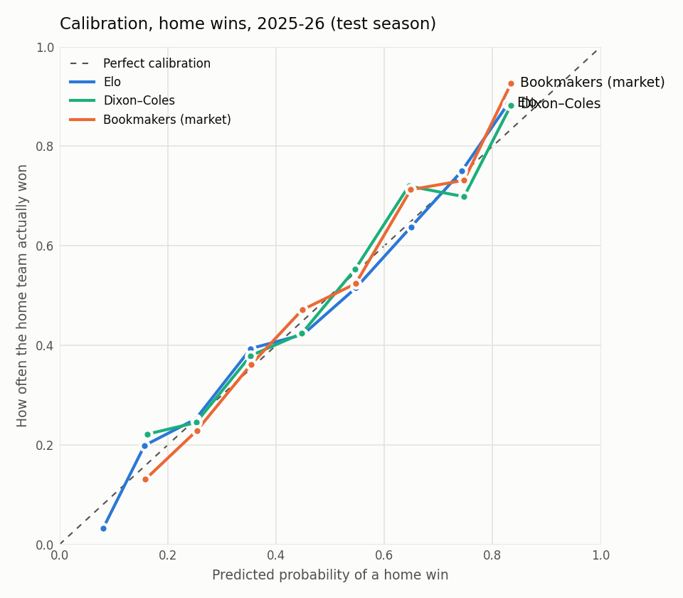

# Week 2: Dixon–Coles goals model

Data source: **football-data** · same split as week 1: tune on **2024-25**, test once on **2025-26**.

The goals model is refit every 7 days per league during each scored season, using only
matches played before the refit. No prediction ever sees its own match or any later one.

## Results on the test season (2025-26)

| Model | Log loss ↓ | RPS ↓ | Brier ↓ | Accuracy ↑ | Matches |
|---|---:|---:|---:|---:|---:|
| League base rates | 1.0712 | 0.2288 | 0.6478 | 44.0% | 1752 |
| Elo | 0.9960 | 0.2032 | 0.5942 | 51.5% | 1752 |
| Poisson (no ρ correction) | 0.9993 | 0.2037 | 0.5958 | 51.5% | 1752 |
| Dixon–Coles | 0.9989 | 0.2037 | 0.5956 | 51.5% | 1752 |
| Blend (Elo + Dixon–Coles) | 0.9945 | 0.2027 | 0.5932 | 51.7% | 1752 |
| Bookmakers (market) | 0.9784 | 0.1977 | 0.5825 | 53.4% | 1752 |

## Validation season (2024-25)

| Model | Log loss ↓ | RPS ↓ | Brier ↓ | Accuracy ↑ | Matches |
|---|---:|---:|---:|---:|---:|
| League base rates | 1.0786 | 0.2330 | 0.6534 | 42.0% | 1752 |
| Elo | 0.9846 | 0.2004 | 0.5869 | 53.1% | 1752 |
| Poisson (no ρ correction) | 0.9850 | 0.2009 | 0.5869 | 52.9% | 1752 |
| Dixon–Coles | 0.9851 | 0.2009 | 0.5870 | 53.0% | 1752 |
| Blend (Elo + Dixon–Coles) | 0.9823 | 0.2000 | 0.5854 | 52.9% | 1752 |
| Bookmakers (market) | 0.9640 | 0.1945 | 0.5731 | 53.6% | 1752 |

## Is the difference real? (paired bootstrap, log loss, test season)

| Comparison | Mean difference | 95% interval | Verdict |
|---|---:|---|---|
| Dixon–Coles vs Elo | +0.0030 | [-0.0042, +0.0101] | no clear difference |
| Blend (Elo + Dixon–Coles) vs Elo | -0.0015 | [-0.0050, +0.0019] | no clear difference |
| Dixon–Coles vs Poisson (no ρ correction) | -0.0004 | [-0.0019, +0.0010] | no clear difference |
| Dixon–Coles vs Bookmakers (market) | +0.0206 | [+0.0125, +0.0280] | second is better |
| Blend (Elo + Dixon–Coles) vs Bookmakers (market) | +0.0161 | [+0.0096, +0.0225] | second is better |

Negative = the first model has the lower (better) log loss.

## Settings (chosen on validation only)

- Dixon–Coles: half-life **365 days**, L2 shrinkage **0.001**, 3-season window, weekly refits.
- Blend: **50% Dixon–Coles + 50% Elo** (linear pool of probabilities).

|   half_life_days |   alpha |   valid_log_loss |
|-----------------:|--------:|-----------------:|
|              365 |  0.001  |           0.9851 |
|              365 |  0.0001 |           0.9858 |
|              730 |  0.001  |           0.9859 |
|              365 |  0.01   |           0.9862 |
|              730 |  0.0001 |           0.9867 |
|              180 |  0.01   |           0.9870 |

## Example predictions (test season)

| Date | Match | xG | P(H / D / A) | Most likely score | Actual |
|---|---|---|---|---|---|
| 2026-05-02 | Bayern Munich vs Heidenheim | 4.32–0.80 | 92% / 6% / 2% | 4-0 (9%) | 3–3 |
| 2026-02-21 | Paris SG vs Metz | 3.82–0.67 | 91% / 6% / 3% | 3-0 (10%) | 3–0 |
| 2026-01-25 | Barcelona vs Oviedo | 3.25–0.45 | 90% / 8% / 3% | 3-0 (14%) | 3–0 |
| 2025-12-07 | Le Havre vs Paris FC | 1.54–1.54 | 38% / 24% / 38% | 1-1 (11%) | 0–0 |
| 2026-05-02 | Union Berlin vs FC Koln | 1.29–1.29 | 36% / 29% / 36% | 1-1 (14%) | 2–2 |
| 2026-04-21 | Brighton vs Chelsea | 1.48–1.48 | 37% / 27% / 37% | 1-1 (12%) | 3–0 |

## Calibration

## Notes

- "xG" here is the model's *expected goals from team strengths*, not shot-based xG.
- The most likely single scoreline rarely has more than ~15% probability. Football is noisy.
- The ρ correction is a small effect and varies by league (strongly negative in the
  Bundesliga and Serie A, near zero in the recent Premier League).
- Promoted teams with no top-flight history start with the strength of the 3 weakest teams.
